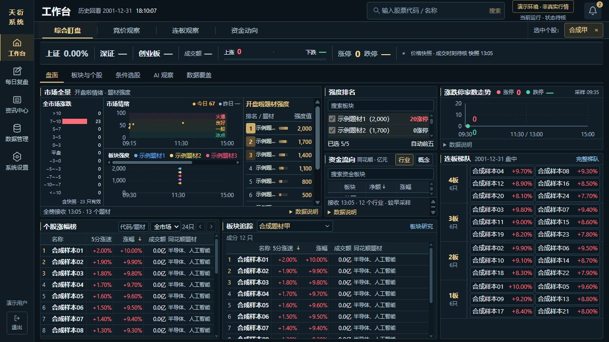
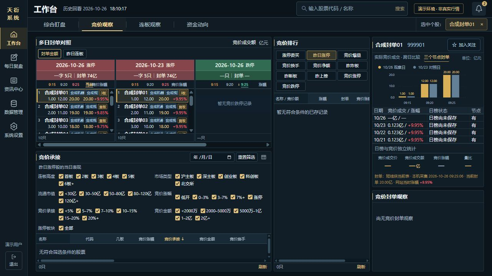
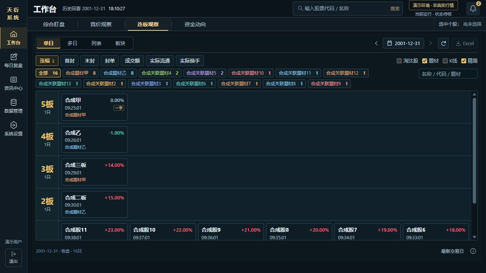

# 天衍系统 · A 股盯盘与复盘工作台

开盘前，想知道一只股票的封单是逐步增加，还是只在最后一个节点跳升？收盘后，想看同一题材的股票走到了几板？天衍把竞价记录、盘中榜单和历史梯队放在一台电脑上，方便你沿着同一个问题往下查。

[下载源码 ZIP](https://github.com/ryancolehk-sudo/tianyan/archive/refs/heads/main.zip) · [本机安装](#本机安装) · [使用自己的模型](#使用自己的模型)



**盘中先看全局，再找个股。** 「综合盯盘」把涨跌分布、题材强度和连板梯队并排展示。发现一个活跃题材，可以到「板块追踪」查看成分股的五分钟涨速和涨幅。读榜时也能看到采样时间，知道自己对照的是哪一刻的行情。

以下图文和上图均来自公开版界面，使用合成行情演示。新建真实实例时数据库为空，接入自己有权限使用的数据源后才会积累记录。

## 开盘前，回看一只股票的三个竞价节点

打开「竞价观察」，在左侧选一只股票，右侧就能把观察日和对照日的 **09:15、09:20、09:25** 封单放在一起看。图里的「合成封单01」从 1 亿、12 亿增加到 20 亿。再往下看，观察日的竞价成交额仍显示「—」：三个封单读数已经有记录，实际成交额还缺一条数据。



## 收盘后，沿着一个题材回看连板梯队

在「连板观察」选定交易日，点一个题材标签，就能把该题材的股票按连板高度展开。图里的五板和四板各有一只，首板一栏则聚集了多只。想追溯梯队怎么形成，可以切到「多日」对照前几个交易日，再到「每日复盘」记录自己的判断。



## 本机安装

准备 Python 3.10 或更高版本，以及支持 Linux 容器的 Docker 和 Docker Compose v2。Windows 用户先安装并启动 Docker Desktop，使用 Linux 容器。项目随后通过 Compose 自动准备数据库、服务、网络和数据卷。首次构建需要联网下载依赖和镜像。解压完整的源码 ZIP，或克隆项目。在含有 `compose.yaml` 的目录执行：

```sh
python scripts/project.py verify-locks
python scripts/project.py init --mode real --project tianyan-local --port 8088
python scripts/project.py start
python scripts/project.py bootstrap --username owner
python scripts/project.py check
```

在终端按提示为自己的管理员设定密码，再打开 [本机工作台](http://127.0.0.1:8088)。默认仅监听本机。8088 已被占用时，在首次初始化时指定其他空闲端口，并用该端口访问。日常启动和停止分别运行 `python scripts/project.py start` 和 `python scripts/project.py stop`。已初始化的实例沿用原目录与配置。

Windows 上完成管理员初始化后，桌面会出现带项目图标的「天衍系统」。保持 Docker 引擎运行，双击图标即可打开工作台；实例已停止时会先启动服务。已有实例可在源码目录运行 `python scripts/project.py shortcut` 补建快捷方式。保留解压目录，以便快捷方式找到启动脚本和图标。

从 ZIP 安装时，启动器会对照 `source-manifest.json` 校验文件。也可以先运行 `python scripts/source_distribution.py check`。从 Git 安装时，启动器记录干净工作区的提交版本。

## 使用自己的模型

1. 以本机管理员身份进入「数据管理 → 接入管理」，在「已接入模型」选择「添加模型」。
2. 选择服务协议，填写自己供应商提供的公网 HTTPS 接口、模型 ID 和 API Key。支持 OpenAI 兼容的 Chat Completions、Responses 及 Anthropic Messages 协议。
3. 「测试调用」或「测试并保存」会向所选接口发送一条短测试请求。成功后选择「设为默认并启用」，再按需开启相应的 AI 功能。供应商按自己的账户和服务条款计费。

首次安装默认关闭 AI。跳过这一步也能登录和使用无需模型的功能。启用后，相关提示词和任务所需数据由本机后端发往所选服务。当前模型连接要求公网 HTTPS，拒绝回环和内网地址。

## 行情与本机数据

需要行情时，在接入管理中添加自己有权限使用的数据源。Tushare 默认使用官方 HTTPS 服务。使用自己获准访问的其他公网 HTTPS 接口时，可将 `JL_TUSHARE_ENDPOINT` 写入本实例的 `.env`，重新启动后再配置连接。数据权限、额度与再分发许可由各供应商分别管理。

`init` 在本机生成数据库密码。模型凭据通过后端写入本实例的加密凭据存储，主密钥由本实例生成。保存好自己的 `.env`、数据库卷、凭据卷和备份，分享代码或提交问题时请移除这些内容。可选配置见 [.env.example](.env.example)。随源码保留的第三方声明见 [第三方组件](THIRD_PARTY_NOTICES.md)。

## 许可证

本项目原创代码以 [MIT 许可证](LICENSE) 发布。随附的第三方组件适用各自的许可，行情数据与模型服务的使用和再分发权限由相应供应商授予。详见 [第三方组件声明](THIRD_PARTY_NOTICES.md)。
